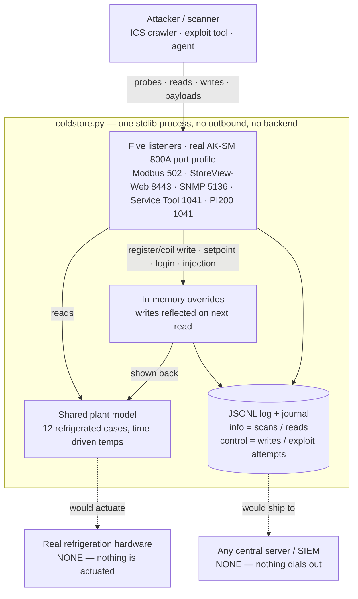

# coldstore — a refrigeration system-manager decoy

A standalone honeypot that imitates an internet-exposed **refrigeration system manager** of the
Danfoss AK-SM family — the surface attackers scanned for in the 2026 campaigns against grocery
chains' cold-chain controllers. The simulated site is a German supermarket. It is one stdlib Python
file (`coldstore.py`) you run directly, beside any existing lure. Five listeners — the exact external port profile of a real AK-SM 800A, verified from the
device firmware's own firewall (`firewall1.sh`) — share one simulated store:

| listener | port | what it imitates |
|---|---|---|
| Modbus/TCP | 502 | the southbound control bus an AK-SM exposes; reads return live case temperatures and setpoints, writes are accepted and reflected |
| StoreView-Web (HTTPS) | 8443 | the remote management UI (`nginx/1.26.0`, title *Danfoss - StoreView Web*): login, dashboard, alarms, configuration, and `xml.cgi` |
| SNMP | 5136/udp | the device's SNMP agent (Danfoss uses fixed UDP **5136**, not 161): answers the system group with the unit's real identity under Danfoss's enterprise OID `1.3.6.1.4.1.9615` |
| Service Tool | 1041/tcp | the Danfoss Service Tool port — a **TLS server** presenting the device certificate (as the real `sm_app` does); captures the client's first application bytes, does not emulate the proprietary protocol inside TLS |
| PI200 | 1041/udp | the Danfoss PI200 discovery port — **decodes and flags** query/scan datagrams (a 64-byte datagram is the device's discovery query); does not reply |

It is a **decoy**. There is no refrigeration behind it — the plant is a time-driven simulation,
and a "write" (a Modbus register write, a setpoint change in the web UI) is stored in memory and
shown back on the next read so the caller believes it took effect, while the attempt is logged as a
control action. Nothing is actuated; nothing reaches out. Run it directly:

```
python3 coldstore.py            # all five listeners on one shared plant; Ctrl-C to stop
```

## Architecture

One process, five listeners, one shared simulated plant, one log — and no path out. It needs **no
backend, no database, no tunnel, and no central server**: `python3 coldstore.py` is the whole thing,
and it never makes an outbound connection.



- **Standalone.** No outbound, no tunnel, no central server, no external dependencies — runs
  anywhere Python 3 runs. The only evidence it produces is its own JSONL log.
- **Decoy only.** A write — a Modbus register/coil, a web setpoint, a login, an injected command —
  becomes an in-memory override shown back on the next read and logged as a `control` event; nothing
  is actuated and no injected command is ever executed, so the published exploit "lands" yet cannot
  pop the host.
- **One shared plant.** All five listeners read and write the same time-driven model, so the Modbus
  control bus and the StoreView web UI always agree.

## What it logs

One JSON line per interaction in `/var/log/coldstore/coldstore.jsonl` (also the journal), with the
caller's real address and an ISO-8601 Europe/Berlin timestamp. Scans and reads are `severity:
"info"`; the actions that matter — a register/coil write, a setpoint change, a login — are
`severity: "control"` and carry the case name and the value the attacker tried to set. Example:

```json
{"ts":"2026-10-12T18:40:11+02:00","proto":"modbus","action":"setpoint","severity":"control",
 "src":"203.0.113.9:51044","fc":6,"node":20,"case":"Tiefkuehltruhe 1","new_setpoint_c":45.0,"register":1020}
{"ts":"2026-10-12T18:41:02+02:00","proto":"storeview","action":"web_login","severity":"control",
 "src":"203.0.113.9:51090","username":"admin","password":"Danfoss2019"}
```

## The simulated store

A fictional German supermarket (`Frischmarkt Gruental`, unit `GRUENTAL-SM01`) with two suction
groups — a medium-temperature rack of chilled cabinets (Wurstwaren, Molkerei, Obst und Gemuese,
Fischtheke, …) and a low-temperature rack of freezers (Tiefkuehltruhen, Speiseeis) — modelled as
twelve Danfoss-style case controllers. Air
temperatures cycle around each setpoint with the compressor, climb during periodic defrost and
recover, and carry a little deterministic noise, so the plant looks alive across restarts. Raise a
setpoint and the case drifts toward it; force a compressor coil off and the cabinet warms. Device
identification over Modbus (FC 43/14) answers `Danfoss` / `AK-SM 800A` / `ADAP-KOOL`.

## Register map (Modbus, 0-based)

| area | address | meaning |
|---|---|---|
| holding (R/W) | `1000 + node` | setpoint, °C×10 signed — the attack target |
| holding (R/W) | `1200 / 1400 / 1600 + node` | alarm high / alarm low / differential |
| input (R) | `3000 / 3200 / 3400 + node` | air temp / evaporator temp / compressor run ratio |
| input (R) | `2900 / 2901` | MT / LT suction pressure, bar×100 |
| coil (R/W) | `100 + node` | compressor enable (0 = forced off) |
| coil (R/W) | `300 + node` | defrost start |
| discrete (R) | `100 + node` | alarm active |

`node` is a case address (1–8 chilled, 20–23 frozen).

## Emulated endpoints and exploit logging

The web side mirrors the real device's structure: an `nginx` front, the page title *Danfoss
StoreView*, and the single API/auth endpoint **`xml.cgi`** (`action=getauth` for authentication,
`action=load_nginx_headers`, `getstatus`, `set_email`, …), plus the configuration pages (network,
users, alarms, e-mail/SMTP, logging, maintenance). It emulates the *presence* of the endpoints
named in the public advisories so an exploit attempt gets a plausible response and is logged as a
high-signal `exploit_attempt`:

| signature | what it matches | from |
|---|---|---|
| `auth_getauth` | `xml.cgi?action=getauth` (the "code of the day" auth path) | CVE-2025-41450 |
| `command_injection_attempt` | shell metacharacters in a settings field (e.g. e-mail/SMTP) | CVE-2025-41451 |
| `path_traversal_attempt` | `../` or `/etc/passwd` in a path or parameter | generic probing |

It does **not** implement the authentication bypass or run any injected command. There is no
vulnerable code behind the endpoints: the honeypot captures the payload verbatim, returns a
believable response, and actuates nothing. The published exploit therefore "lands" (the attacker
sees a response and is logged) but cannot compromise the host — which also means a genuine
firmware-level exploit will not pop it, by design.

## Install

```
sudo ./install.sh          # user, cert, systemd unit, firewall; prints a health check
sudo ./uninstall.sh        # keeps the log; --purge removes cert, log and user
```

Hardened unit (`coldstore.service`): runs as the unprivileged `coldstore` user with only
`CAP_NET_BIND_SERVICE`, a read-only filesystem apart from the log directory, a syscall filter,
memory and task caps, and no outbound capability. The web listener uses a self-signed device-style
certificate (`/etc/coldstore/`). Robust against malformed input: bounded reads, per-connection
request and idle limits, a per-address connection cap, and correct Modbus exception responses.

## Tests

```
python3 -m unittest test_coldstore      # Modbus, web UI, SNMP, the proprietary ports, logging
```

41 tests: Modbus framing and semantics, the StoreView web surface (incl. byte-exact nginx
error/405/204 fixtures), the SNMP system group (v1/v2c GET + GETNEXT walk, Danfoss OID, bad-community
drop, SET logged as control and changes nothing), the Service Tool TLS handshake (presents the
device cert over TLS 1.2; a plaintext probe fails the handshake and is logged) and PI200
query-flagging, and that every interaction is logged with the right severity.

## Discovery

All five ports are reachable from the internet, so Shodan / Censys / ZoomEye crawlers index the
decoy on their own over time: Modbus 502 reports `Danfoss AK-SM 800A`, 8443 shows `nginx` +
*Danfoss - StoreView Web*, and SNMP on 5136/udp answers `sysDescr = Danfoss AK-SM 800A ADAP-KOOL
System Manager, firmware G08.053` with `sysObjectID = enterprises.9615` — three independent,
mutually-consistent Danfoss fingerprints. An on-demand Shodan scan to index it immediately needs a
paid Shodan plan with scan credits (`POST https://api.shodan.io/shodan/scan ips=<IP>`); the free OSS
tier returns "upgrade your API plan", so discovery is left to the passive crawlers.

## Verified against the real firmware

The device fingerprint is not guessed. The AK-SM 800A ships its base OS as a public, ungated
download (`Danux4.14.017.194.lpk`, a 7-Zip wrapping a SWUpdate `.swu` → an ext4 root filesystem
for an NXP i.MX6 / MSC-SM2 module, Yocto "Poky 2.5"). Unpacking it confirms the surface this decoy
presents:

| fact | value (from firmware) | where |
|---|---|---|
| web server | **nginx/1.26.0** | `/usr/sbin/nginx`, error-page body |
| web architecture | public nginx → `sm_fcgi_app` FastCGI auth proxy → `sm_app` | `/opt/scripts/sm_app.sh` |
| internal proxy ports | HTTP `3080`, HTTPS `3443` (external HTTP/HTTPS DNAT'd in) | `/opt/scripts/firewall1.sh` |
| TLS server cert | subject `CN=DanfossSM800A, OU=SM800A, O=Danfoss, L=Baltimore, ST=MD, C=US` | `/opt/create_ssl_cert.sh` |
| TLS issuer (CA) | `CN=SelfSigned-DanfossSM800A, OU=Certificate_Authority` | same |
| external ports | TCP 22 (ssh), TCP 1041 (Service Tool) + UDP 1041 (PI200), UDP 5136 (SNMP), HTTP/HTTPS | `firewall1.sh` |
| internal-only | UDP 5003/5005 (host net), TCP 3080/3443 (proxy targets) | `firewall1.sh` |

`install.sh` reproduces that exact certificate chain and the banner is set to the exact nginx
version, so an attacker who inspects the TLS certificate or the `Server` header sees what a real
device shows. The vulnerable binary itself (`sm_fcgi_app`, where CVE-2025-41450/41451 live) is **not**
in this base-OS package — it is delivered on the device's `/danfoss` application partition — so the
decoy's endpoint behaviour is modelled from the public Claroty advisories, never copied from
vulnerable code, and nothing exploitable was reconstructed.

### The port profile (SNMP 5136, Service Tool / PI200 1041)

The decoy opens the same external ports a real AK-SM 800A does. Where the host already uses TCP 22
(SSH or your lure) and 80/443 (another site), StoreView keeps its 8443; the three remaining device
ports are served directly:

- **SNMP, UDP 5136.** The firmware ships no net-snmp agent or MIB — the AK-SM's SNMP is Danfoss
  proprietary and primarily trap-oriented — so this is a **modelled** minimal SNMP v1/v2c responder
  for the system group only. It answers GET/GETNEXT with the unit's real identity (`sysDescr =
  Danfoss AK-SM 800A ADAP-KOOL System Manager, firmware G08.053`, `sysObjectID = 1.3.6.1.4.1.9615`,
  the Danfoss IANA enterprise number), drops a wrong community silently (as a real agent does, and
  so it is not an amplification relay), and refuses SET while logging it as a control event. It
  exists so a scanner can fingerprint the box as Danfoss; it reconstructs no device-specific logic.
- **Service Tool, TCP 1041.** Reverse-engineering the real server binary `sm_app` (full DWARF; see
  [`analysis/`](analysis/)) shows this port is a **TLS server**: `sm_app` calls `SSL_accept` /
  `SSL_CTX_use_certificate_file` (OpenSSL 1.0.2d) presenting `/danfoss/certs/st_cert.pem`, then
  speaks a proprietary protocol of ~1617 `TFN_*` transaction functions *inside* TLS. The decoy now
  presents that TLS layer exactly — a TLS scanner (nmap `ssl-enum-ciphers`, Shodan) sees a real
  handshake and the device certificate — then captures the client's first application bytes and
  closes. The TFN layer is **not** emulated: it is unspecified, and a wrong reply inside TLS would
  be a worse tell than silence.
- **PI200, UDP 1041.** `sm_app`'s `PI200_send_query` emits a **64-byte** discovery query to udp/1041;
  node records travel as the 128-byte `eth485_node` struct (`protocol_version`, `store_name[31]`,
  `unit_name[31]`, `ip_address`, versions, `checkbyte`). The decoy **decodes and flags** inbound
  query/scan datagrams (`pi200_query` for the 64-byte shape) but sends **no reply**: the response
  envelope is not recoverable from the binary without inventing it, which this decoy never does.

The full reverse-engineering notes, the certificates, the struct layouts, the `TFN_*` catalogue and
the captured handshakes live in [`analysis/`](analysis/), alongside a per-protocol accuracy judgment.

**Run dynamically.** The device's own nginx binary (ARM EABI5, from the rootfs) was executed under
emulation: it reports `nginx/1.26.0`, `built with OpenSSL 1.0.2o (2018)`, cross-built for `arm`,
with `--http_ssl_module`/`gzip_static`/`threads`. A live nginx 1.26.0 was then run as a server and
its exact error responses captured on the wire; the decoy now emits a **byte-identical** nginx 404
and 405 (fixed template, `Content-Type: text/html` with no charset, header order `Server, Date,
Content-Type, Content-Length, Connection`, `Connection` mirroring the request). Previously unknown
paths returned a themed "page not found", an easy tell. The base `/etc/nginx/nginx.conf` in the
package is an incomplete leftover — at runtime `sm_app.sh` starts nginx with
`/danfoss/nginx-auth-proxy/nginx.conf` from the application partition — which is the final
confirmation that the StoreView web config and its login/`xml.cgi` responses are not in this
download and remain modelled from the public advisories.

## The application firmware (StoreView web surface)

The **application** firmware also downloads ungated (`SM800A-5.3.2.spk`, a 7-Zip over the same
SWUpdate wrapper, ~47 MB) and contains the StoreView web application and its nginx config -- the
layer absent from the base-OS package. From it the decoy's HTTP surface is now matched to the real
device, not inferred:

- **`xml.cgi` is POST-only.** The real `location ~ \.cgi$` returns `405 Not Allowed` for GET/HEAD
  and `204 No Content` for `OPTIONS`; only `POST` reaches the FastCGI app. The decoy does the same
  (and still logs an exploit-shaped GET as a probe).
- **Five response headers on every reply** (from `headers.conf`, applied `always`, so they appear
  on errors too): `Cache-Control: no-store, no-cache`, `Access-Control-Allow-Origin: *`,
  `Access-Control-Allow-Methods: GET, POST, OPTIONS`, an `Access-Control-Allow-Headers` list that
  includes the device's custom `aksm-auth` token header, and `Strict-Transport-Security`.
- **TLS 1.2 only**, with the device's exact nginx cipher list.
- **Page title** `Danfoss - StoreView Web`, root served with `try_files ... =404`.

The decoy's 404/405/204 responses are **byte-for-byte** equal to the real device's (fixtures in
`testdata/`, asserted by the test-suite). The full React SPA (hundreds of JS chunks, tens of MB) is
deliberately **not** shipped -- it is not a scanner/fingerprint surface and would bloat a stdlib
lure -- so a browser sees the real shell but an empty app. The vulnerable `sm_fcgi_app` binary is
present in the firmware but its auth/injection logic was **not** read into the decoy: endpoint
behaviour stays modelled, nothing exploitable was reconstructed.

## Logging and integration

This runs standalone; its evidence is its own JSONL log (and the systemd journal). It makes no
outbound connection and needs no central server. To centralise, tail the `severity: "control"`
events into your own SIEM or log pipeline — there is no built-in phone-home.
